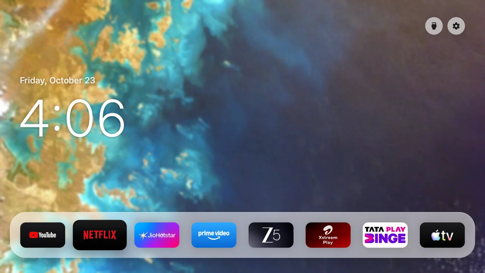
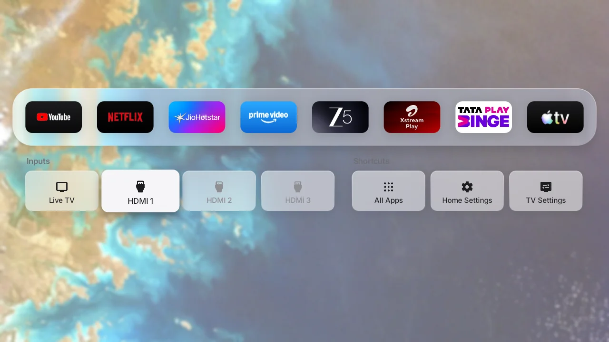
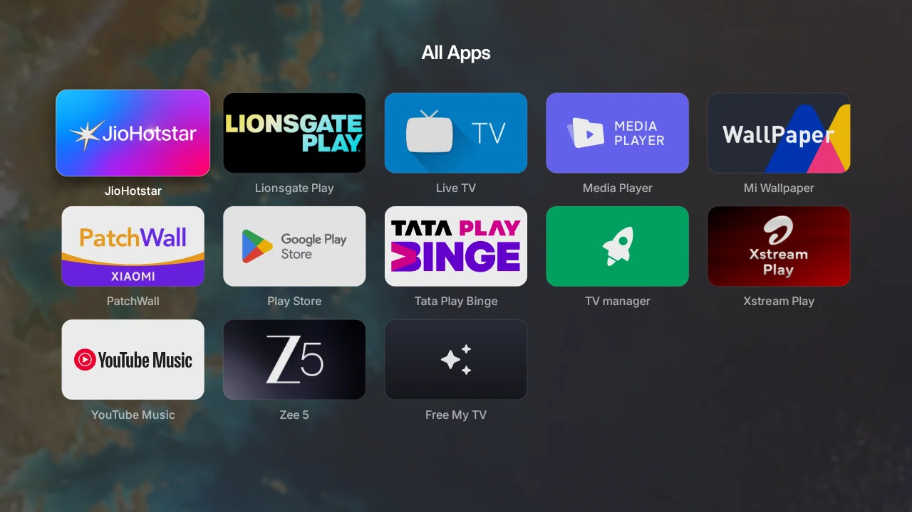
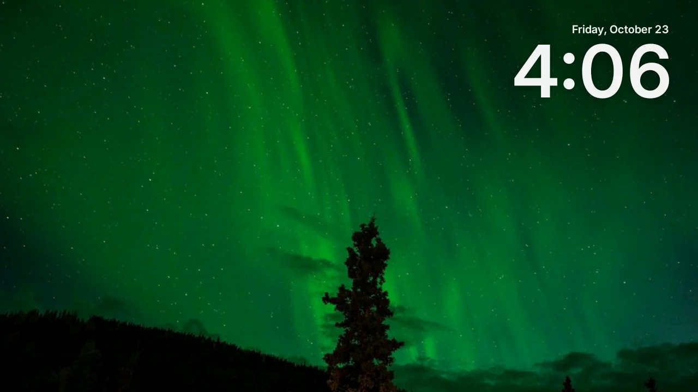

# Arif Home TV

> **Changes in this fork.** An offline fork of [Free My TV](https://github.com/simbasjungles/free-my-tv) (MIT), tuned for an Android 9 TV with 1 GB of memory:
>
> - **Why this fork.** Upstream's frosted-glass look needs a higher-end TV (Android 13 shaders, a capable GPU, more memory). This is a separate, lighter copy for lower-end models: the same frosted look, drawn from pre-blurred photos, with a few theme changes.
> - **Fully offline.** No internet permission. No TMDB picks, weather or crypto. Day and night follow a sunrise/sunset calculated on the TV.
> - **Frosted glass on Android 9.** Five bundled photos rotate daily behind the glass ([credits](app/assets/wallpapers/CREDITS.md)). The shelf, buttons and drawer draw a pre-blurred copy of the photo, so the glass works without Android 13's shaders.
> - **Nothing privileged.** The in-app ADB client, home switching, app disabling, boot receiver and accessibility service are removed. The app asks for no permissions; set it as the home screen once with adb.
> - **Shelf and remote.** The shelf defaults to the TV's installed streaming apps. Down from the shelf opens HDMI inputs. Several frame-time fixes for older TVs.
> - **Android TV only.** Upstream's LG and Samsung versions are not included (see [Supported TVs](#supported-tvs)).
>
> | Home | Inputs (Down from the shelf) | All Apps |
> |---|---|---|
> |  |  |  |
>
> | Settings | Screensaver |
> |---|---|
> |  |  |

## Supported TVs

Any TV or box running Android TV or Google TV, Android 8 or newer. Nothing in the app is specific to one brand: HDMI inputs and the Wi-Fi button use standard Android APIs, and the UI scales down on TVs that draw at 720p. It was built and tested on a Xiaomi Mi TV (Android 9, 1 GB of memory).

| TV or device | Works | Notes |
|---|---|---|
| Android TV 8+ (Xiaomi, Sony, TCL, Philips, Hisense Android models, Nvidia Shield…) | Yes | |
| Google TV (Chromecast with Google TV, newer Sony and TCL) | Mostly | Becoming the home screen means disabling Google's launcher with adb; some system updates turn it back on. |
| Amazon Fire TV | Partly | Installs and runs as an app, but newer Fire OS doesn't let another app take over the Home button. |
| Samsung (Tizen), LG (webOS) | No | Not Android. Upstream [Free My TV](https://github.com/simbasjungles/free-my-tv) has versions for both, without this fork's changes. |
| Roku, Apple TV | No | |

What changes from one TV to the next is the setup, not the app: each brand ships its own launcher (Google's `com.google.android.tvlauncher`, Xiaomi's PatchWall `com.mitv.tvhome.atv`, and so on), and that launcher has to be disabled with adb before this one can be the home screen. Disable it, don't uninstall it: `adb shell pm enable <package>` brings it back.

## Install

You need an Android TV or Google TV (Android 8 or newer) and a computer on the same Wi-Fi.

1. **On the TV**, turn on developer mode: Settings → System → About → press *Android TV OS build* 7 times. Then Settings → System → Developer options → **USB debugging**. Note the TV's IP address.
2. **Tools:** a JDK 17+, the Android SDK command-line tools (build-tools 34, platform android-34) and adb.
3. **Build:** `./build.sh`. The first run creates `config.properties`; set `latitude` and `longitude` (used for sunrise and sunset), then run it again.
4. **Install:**
   ```bash
   adb connect <TV-IP>:5555
   adb install -r FreeMyTV.apk
   ```
5. **Set it as the home screen once** with adb (the app asks for no permissions).

## Credits and license

Based on [Free My TV](https://github.com/simbasjungles/free-my-tv) by simbasjungles (MIT), which has the full project: LG and Samsung versions, picks, weather and the website. Icons: [Material Symbols](https://fonts.google.com/icons) (Apache 2.0). Font: [Inter](https://rsms.me/inter/) (SIL OFL 1.1). Photo credits: [app/assets/wallpapers/CREDITS.md](app/assets/wallpapers/CREDITS.md). Not affiliated with Google, TCL or any streaming service.

[MIT](LICENSE).
